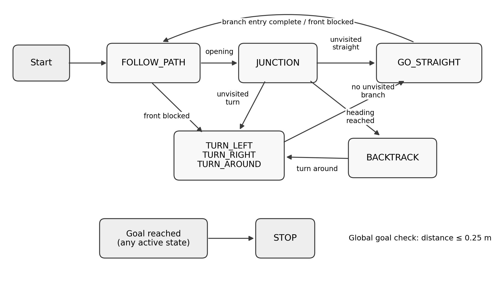
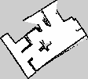

# Autonomous Maze Navigation with iRobot Create 3

**Python · ROS 2 Jazzy · RPLIDAR · Finite State Machine · Odometry · SLAM Toolbox**

**Implemented by Sepehr Samari Shirabad** · [GitHub profile](https://github.com/sepsamari)

This repository showcases **my independent software implementation** for an academic robotics challenge in the **Smart Systems Engineering** master's program at **Hanze University of Applied Sciences** (2026). I developed the Python/ROS 2 maze-navigation controller, configured LiDAR-based SLAM mapping, and documented and evaluated the system on an iRobot Create 3.

The robot navigates an initially unknown maze using sensor feedback and a finite-state machine. A separate SLAM Toolbox process produces a two-dimensional map for visualization; the navigation controller does **not** rely on this map for path planning.

## Demonstration results

| Trial | Observation |
| --- | --- |
| **Round 1** | Reached the goal in **1 min 25 s (85 s)**, within the **8-minute limit** |
| **Round 2** | Temporarily became stuck in a narrow, wall-surrounded area; eventually reached the goal |
| **Mapping** | A SLAM occupancy-grid map was saved for **round 2**; no map file is available for round 1 |


## Navigation architecture



The controller uses an **FSM** with `FOLLOW_PATH`, `JUNCTION`, `TURN_LEFT`, `TURN_RIGHT`, `TURN_AROUND`, `GO_STRAIGHT`, `BACKTRACK`, and `STOP` states. Key behaviors:

- **LiDAR segmentation:** front sector (−15° to +15°) uses the minimum valid range for obstacle detection; left (+75° to +105°) and right (−105° to −75°) use median ranges.
- **Adaptive wall tracking:** tracks whether each side is a wall or opening and confirms changes over multiple scans.
- **Proportional steering:** follows one wall relative to an adaptive reference or centers between two detected walls. Angular velocity correction is clamped.
- **IR avoidance:** proximity-intensity groups provide additional short-range steering corrections.
- **Junction memory:** records junction coordinates, branch headings and previously selected branches.
- **Goal-biased exploration:** among unexplored branches, prioritizes the heading nearest the direction of the measured goal. This is **DFS-like**, not guaranteed shortest-path planning.
- **Odometry:** tracks position/yaw, interprets manually measured goal offsets and checks when the goal is within the configured position tolerance.

### ROS 2 topics

| Topic | Type | Used for |
| --- | --- | --- |
| `/scan` | `sensor_msgs/msg/LaserScan` | LiDAR perception |
| `/robot_1/ir_intensity` | `irobot_create_msgs/msg/IrIntensityVector` | Close-range obstacle sensing |
| `/robot_1/odom` | `nav_msgs/msg/Odometry` | Position and heading feedback |
| `/robot_1/cmd_vel` | `geometry_msgs/msg/Twist` | Velocity commands |

## SLAM mapping (separate from navigation)



*Occupancy-grid map of the second demonstration maze: black = occupied, white = free, gray = unknown. The image is the saved SLAM output, not a ground-truth floor plan.*

The mapping launch uses **`rplidar_ros`**, a static `base_link → laser` transform and **SLAM Toolbox's asynchronous mapper**, consuming `/scan` and robot transforms. The saved files are [`slam/maze_map_final.pgm`](slam/maze_map_final.pgm) and [`slam/maze_map_final.yaml`](slam/maze_map_final.yaml). The map is **112 × 101 cells** at **0.05 m/cell**, or a **5.60 × 5.05 m grid extent**.

**Important:** the FSM **does not** use the SLAM occupancy grid to localize or plan paths. SLAM was used for map generation and visualization only.

## Repository contents

```text
controller/
  MazeController.py             # Demonstration controller source (preserved)
slam/
  slam.launch.py               # Launch file, duplicate definition removed
  maze_map_final.pgm           # Native second-round occupancy grid
  maze_map_final.yaml          # Map resolution, origin and thresholds
docs/
  fsm_flowchart.png            # Controller state diagram
  second_round_slam_map.png    # PNG preview of the saved PGM
README.md
.gitignore
```

## Environment and reproduction notes

- iRobot Create 3 with a Raspberry Pi and an attached RPLIDAR
- ROS 2 **Jazzy**, `rclpy`, `irobot_create_msgs`, `rplidar_ros`, `slam_toolbox`, `tf2_ros`, and NumPy
- The robot's networked ROS 2 topics and TF tree must already be functioning.
- For the navigation controller, **before every run** assign measured numeric values (meters) to `goal_forward_from_start` and `goal_right_from_start` in `controller/MazeController.py`. They appear as `None` in the archived source because each trial required fresh manual measurements. Positive `goal_right_from_start` is rightward.
- With the ROS 2 environment configured and message packages available on the Raspberry Pi, the controller source can be started with `python3 controller/MazeController.py`. **This package has not been validated as a plug-and-play, standalone installation.**
- The supplied SLAM launch refers to `create3_lidar_slam/config/mapper_params_online_async.yaml`, an **external configuration not included in this portfolio**. That dependency must be supplied before running the mapper.
- The launch file's `base_link → laser` static transform uses zero offsets in the supplied source and was commented as a temporary configuration. The real mounting pose must be measured and configured before relying on the transform.
- The original launch source declared `generate_launch_description()` twice. For readability, the portfolio copy retains the **second, effective definition**; no extra motion-update thresholds are claimed here.

**Safety:** test on the actual robot only in a supervised, clear environment with a working emergency stop.

## Limitations and future improvements

- Navigation instability in narrow, enclosed spaces
- Junction matching and opening detection depend on geometry and sensor readings
- No shortest-path guarantee and no quantitative position-error evaluation
- Potential next steps: robust recovery behaviors, and integration of SLAM localization/map-aware planning

## What I implemented

- Designed and programmed the **Python / ROS 2 finite-state navigation controller**, including motion control, wall following, and turning behaviors.
- Integrated and processed **LiDAR, IR proximity, and odometry** feedback to support navigation in an unknown maze.
- Developed **adaptive wall/opening detection**, **junction memory**, and **goal-biased branch selection**.
- Configured and ran **RPLIDAR + SLAM Toolbox** mapping, exported the second-round occupancy grid, and documented the mapping pipeline.
- Tested, tuned, and documented the implementation and its practical limitations.


The project was developed for an academic demonstration; the code is not presented as a fully validated, production-ready navigation stack.
